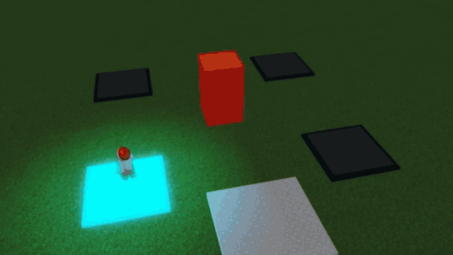
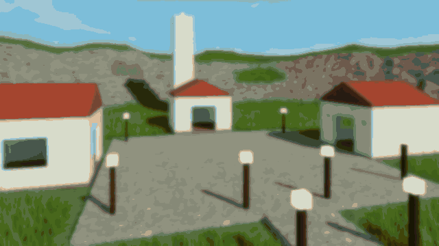
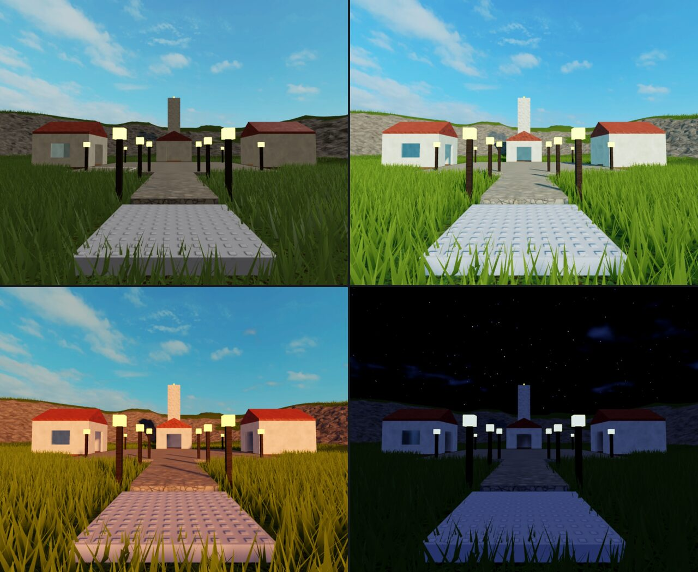
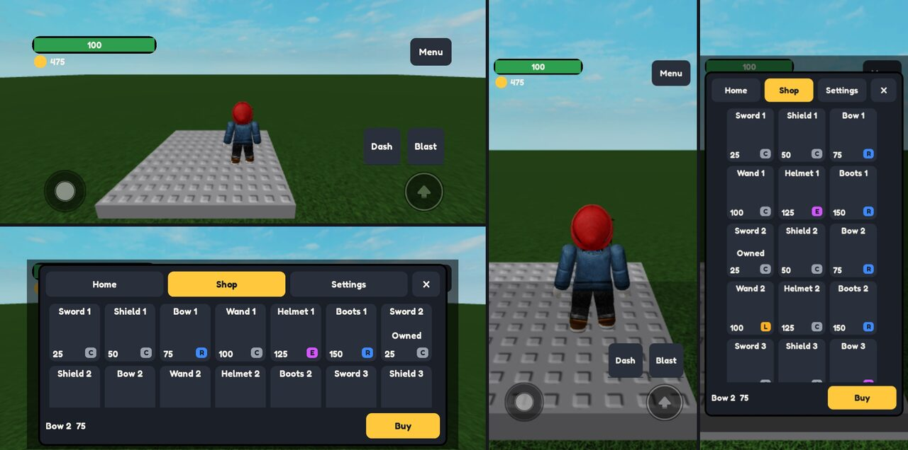
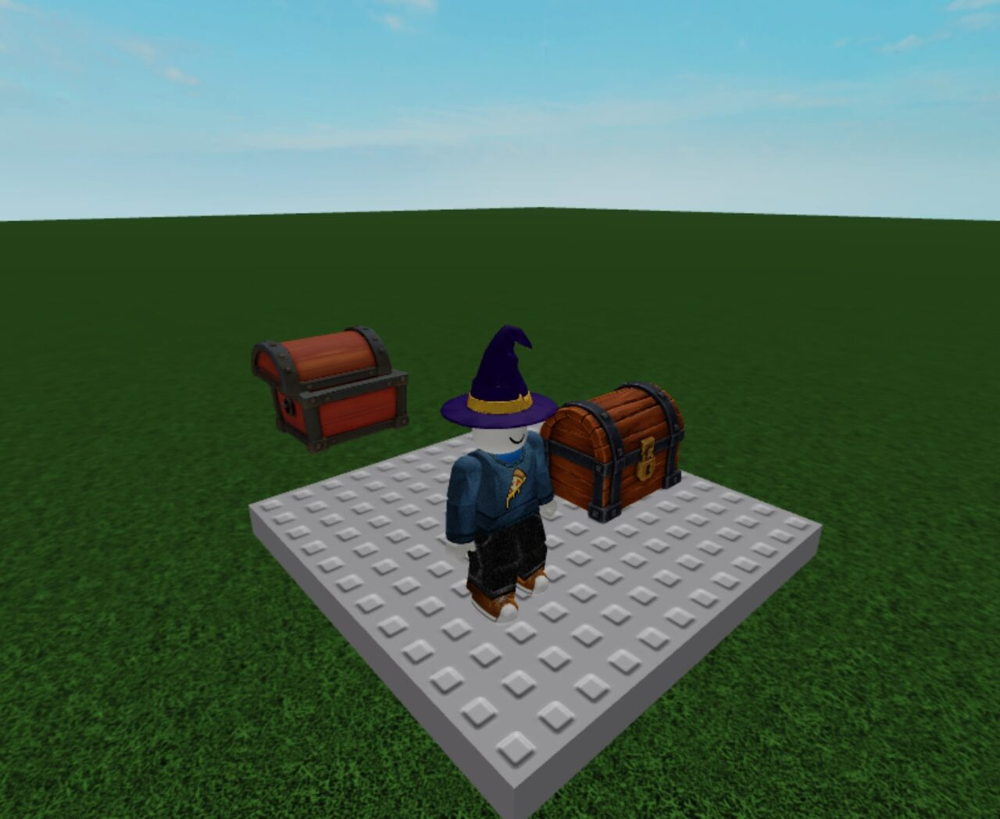

# Roblox Studio Expert Skills

Agent skills that let Claude (Claude Code) or Codex build in Roblox Studio the way the experts in
the best tutorials, Roblox Developers Conference talks and official documentation do. Built on
2026-10-18 and 2026-10-19 with the same method as [Godot Expert Skills](../godot/README.md) and
[Unity Expert Skills](../unity/README.md): transcripts of top-rated videos, cited expert notes, then
skills with tools and review rubrics, graded blind against the same model without them. Every
procedure was also run live in Roblox Studio 0.743 through its built-in MCP server. Start with the
lead skill, `scenario-roblox-expert`.

## Skills

| Skill                          | Use it when                                                                                                                                              |
| ------------------------------ | -------------------------------------------------------------------------------------------------------------------------------------------------------- |
| `scenario-roblox-animation`    | animating Roblox characters, NPCs or creatures: animation not playing, wrong animation wins, animation priority or weight, blending, animation events... |
| `scenario-roblox-architecture` | structuring Roblox game code: where scripts go (ServerScriptService, ReplicatedStorage, StarterPlayerScripts), Script vs LocalScript and RunContext...   |
| `scenario-roblox-assets`       | bringing 3D assets into Roblox Studio or preparing avatar items: import from Blender, GLB, FBX or OBJ files, AI-generated or image-to-3D meshes...       |
| `scenario-roblox-data`         | a Roblox game saves or loads player data, or when players report data not saving, lost progress, rollbacks, duplicated items or a purchase granted...    |
| `scenario-roblox-environment`  | building or lighting a Roblox map: graybox or blockout, level layout, landmarks, doors and walls, parts versus unions (CSG), collision fidelity...       |
| `scenario-roblox-expert`       | an agent builds, fixes or tests anything in Roblox Studio: "make a Roblox game", "Roblox Studio", a Luau script, "my Roblox game lags", agent control... |
| `scenario-roblox-gameplay`     | building Roblox gameplay systems: NPC or enemy AI that patrols, chases and attacks, state machines or behavior trees, 'NPC pathfinding stuck', 100...    |
| `scenario-roblox-luau`         | writing, reviewing or debugging Luau in a Roblox experience: task.spawn vs task.defer vs task.wait, replacing wait() or spawn(), Deferred events and...  |
| `scenario-roblox-monetization` | a Roblox game sells something or plans live ops: Developer Products, game passes, experience subscriptions, Roblox Plus perks, ProcessReceipt or...      |
| `scenario-roblox-networking`   | securing a Roblox experience against exploiters or designing its networking: RemoteEvent, RemoteFunction or UnreliableRemoteEvent design, validating...  |
| `scenario-roblox-performance`  | a Roblox experience is slow, laggy, stuttering, crashing or out of memory, or before shipping or updating one: my game lags on mobile, low FPS, frame... |
| `scenario-roblox-tooling`      | setting up or repairing a Roblox team project outside Studio: Rojo or Script Sync, Wally packages, Rokit pins, luau-lsp type checking, Selene...         |
| `scenario-roblox-ui`           | building or fixing Roblox game UI or input: HUD (health bar, currency, ability cooldowns), main menu, shop with a scrolling grid, settings screen...     |
| `scenario-roblox-vfx-audio`    | making or fixing Roblox visual effects or game audio: ParticleEmitter, Beam, Trail, flipbook sprite sheets, slash, hit, impact, explosion, fireball...   |

## Status

- 14 skills (the lead `scenario-roblox-expert`, which carries the shared Python toolkit `rbx_*` and
  the Luau AgentKit, plus 13 specialists) written from 214 expert videos with transcripts and 85
  documentation pages and articles. Each specialist has references, a Python module and Luau kit
  code.
- Verified live: every procedure was run in Roblox Studio 0.743 on macOS (Apple Silicon), on local
  places that were never published. The runs used Luau in Edit through the MCP server, playtests
  with Server and Client code, simulated keys, mouse and walking, captures that were looked at, and
  Rojo builds. Every skill's offline suite (luau and Lune, both Luau type solvers, Rojo builds,
  Python units) passes too. Per-skill live counts as reported by each skill's own suite:

| Skill                          | Live tests in Studio 0.743                                 |
| ------------------------------ | ---------------------------------------------------------- |
| `scenario-roblox-expert`       | 36                                                         |
| `scenario-roblox-architecture` | 14                                                         |
| `scenario-roblox-luau`         | 17                                                         |
| `scenario-roblox-networking`   | 24, 1 skipped (Server Authority runs in its own place)     |
| `scenario-roblox-data`         | 26                                                         |
| `scenario-roblox-tooling`      | 14, plus 27 offline                                        |
| `scenario-roblox-environment`  | 17                                                         |
| `scenario-roblox-vfx-audio`    | 17                                                         |
| `scenario-roblox-ui`           | 16                                                         |
| `scenario-roblox-animation`    | 23                                                         |
| `scenario-roblox-gameplay`     | 23                                                         |
| `scenario-roblox-assets`       | 12                                                         |
| `scenario-roblox-performance`  | 25, 4 skipped (viewport counters and MicroProfiler labels) |
| `scenario-roblox-monetization` | 16 (61 kit tests inside Studio)                            |

- Blind-graded written scenarios (12 production briefs): 60 % without the skills (108/180), 97 %
  with them (174/180). All twelve scenarios improved. One grader per scenario and one answer per
  condition, so read it as a direction, not a statistic. Both agents wrote plans without driving
  Studio. Every point both answers missed went back into its skill before the live suites were
  rerun. Two scenarios were regraded once after that refactor (code architecture and gameplay, 13 to
  15 each).
- Not run: publishing, Open Cloud calls against a live experience, Marketplace and UGC uploads
  (avatar items were taken up to Roblox's validation only), real purchases, ads, analytics and
  configs on a published experience, live DataStores (the data layer ran against a simulated
  multi-server backend), multi-client tests (each MCP playtest is one client), Team Create, phones,
  consoles and VR, and Windows. Each skill lists what it could not run.

## In Studio

The [live evidence](../../../tests/scenario-roblox-expert/evidence/README.md) shows the skills' own
test runs: four screen recordings, 30 screenshots with their test numbers, a one-page PDF per skill,
a 3-page overview and the blind-test table. Each GIF below links to its MP4.

[](../../../tests/scenario-roblox-expert/evidence/videos/scenario-roblox-expert-agent-playtest.mp4)
[](../../../tests/scenario-roblox-expert/evidence/videos/scenario-roblox-environment-lighting-moods.mp4)





## Requirements

- Roblox Studio 0.743 or later (`brew install --cask robloxstudio`; it updates itself), signed in to
  a Roblox account. Turn on its MCP server once: Assistant, then Manage MCP Servers, then "Enable
  Studio as MCP server". Tested on macOS (Apple Silicon) only: the toolkit's process, window and GPU
  checks use macOS commands.
- Python 3.9+ (system `python3`) for the runner-side toolkit; the core uses the standard library.
  Optional: Pillow (capture checks), Blender 5.2 (animation and asset preparation), ffmpeg (audio
  preparation).
- File tooling for the offline checks and Rojo projects: Rojo 7.7, luau 0.743, Lune 0.11, Selene
  0.32, StyLua 2.6 and luau-lsp 1.70 (`brew install` or Rokit).

The lead skill `scenario-roblox-expert` explains the execution channels: the Studio MCP server in
Edit, playtests driven by code, offline Luau checks, Rojo files, headless RunScript and Open Cloud
Luau Execution. It also caps how many place windows run at once and waits while the machine is
loaded.

## Install

```bash
npx skills add scenario-labs/skills --skill scenario-roblox-expert scenario-roblox-animation scenario-roblox-architecture scenario-roblox-assets scenario-roblox-data scenario-roblox-environment scenario-roblox-gameplay scenario-roblox-luau scenario-roblox-monetization scenario-roblox-networking scenario-roblox-performance scenario-roblox-tooling scenario-roblox-ui scenario-roblox-vfx-audio
```

The installer puts the skills side by side, which the specialists need: they import the lead skill's
`scripts/` (Python toolkit and Luau AgentKit). In the installer picker
(`npx skills add scenario-labs/skills`), the family is the "Expert tools: Roblox Studio" group.
Update with `npx skills update`.

## Provenance

Built for this repository in Emmanuel de Maistre's build project, with no separate skills
repository. The skills were written with this repository's names, frontmatter (`name`,
`description`, `license`) and sibling-install line from the start.

Paths such as `tests/code/...`, `tests/places/...` or `tests/live_evidence/...` inside the skills
point to the build project (tests, live evidence) on the author's machine; they are provenance only
and are not part of this repo.
