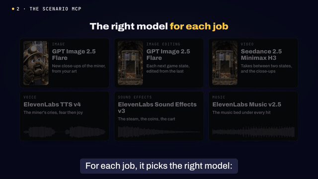

# Scenario Game UA Ads: evidence

What the [scenario-game-ua-ads](../../../skills/scenario-game-ua-ads/SKILL.md) skill produced in its
test runs, on 2026-11-03 and 2026-11-04. Eleven 15 s 1080x1920 ads were made by agents with the
skill through the Scenario MCP, each from a one-line concept, and reviewed for game logic on
native-resolution crop sheets.

## Explainer film

How one of these ads gets made, on the Gold Rush Rescue example, from its real production files.
3:14, 1280x720, with narration and subtitles. Poster:
[scenario-game-ua-ads-explainer_poster.jpg](videos/scenario-game-ua-ads-explainer_poster.jpg).

- **Opening:** the eleven ads, and the test every beat must pass: "I really want to try this game".
- **The brief:** the concept, game name, placement, length, and the game's own material.
- **The Scenario MCP:** one connection to the public catalog. The agent picks a member for each job
  (images, image edits, video, voices, sound effects, music) with `recommend` and a newest-first
  `search`, and runs two members on the same input when they are close. It checks each result and
  keeps every asset in the Scenario project, traced to the asset it was made from.
- **The picture and the finish:** the eight stages on the real files: plan, board, clips, logic, UI,
  assemble, sound, check.
- **The test and the logic check:** the six want-to-play rules, each shown in an example ad, and a
  rejected take caught on its crop sheet.
- **Make yours:** install the skill, connect the Scenario MCP, give the agent one line.

Every frame comes from the example ads and their production files; nothing was generated for the
film. No team, project, or asset identifiers appear in it.
